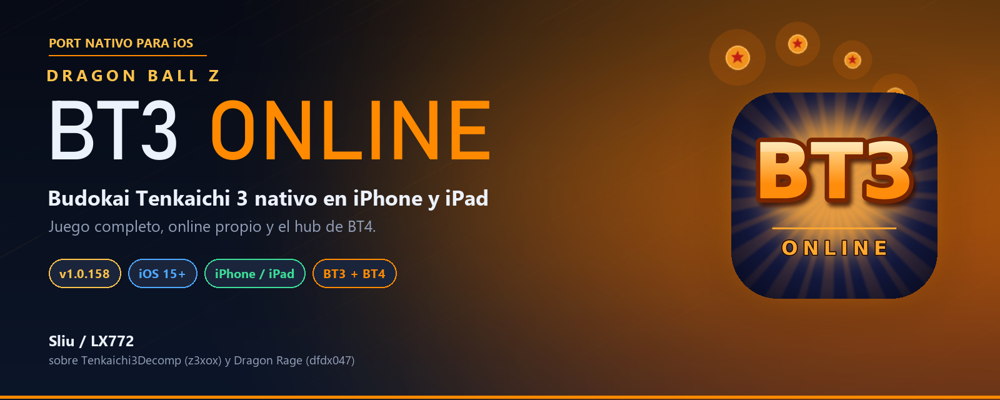
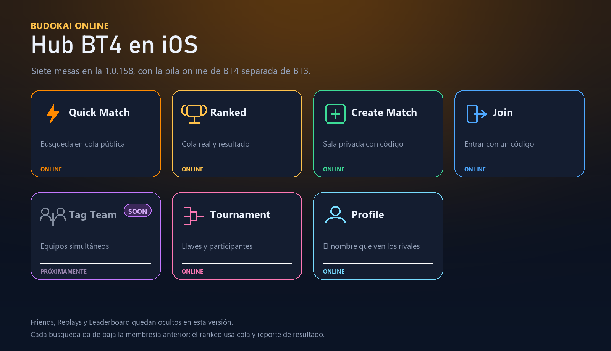
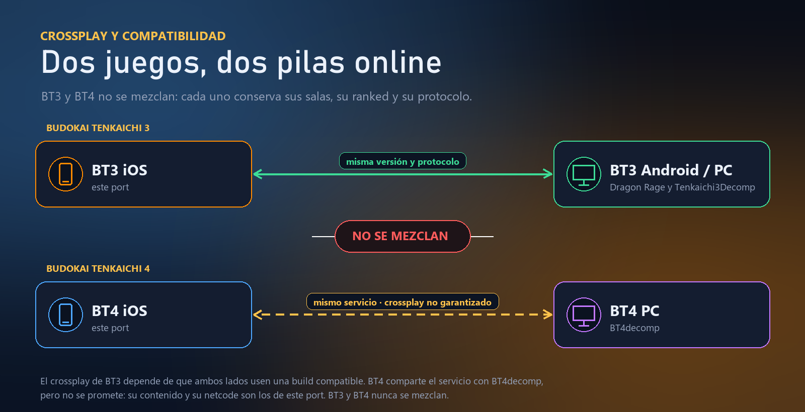

<div align="center">



<h1>BT3 Online iOS</h1>

<p><strong>Dragon Ball Z: Budokai Tenkaichi 3</strong> (PS2, SLUS-21678) corriendo de forma <strong>nativa en iPhone y iPad</strong>.<br>
No es un emulador: es el código del juego decompilado y compilado para iOS, con renderizado, controles y online propios.</p>

<p>


</p>

<p>
<a href="https://shrinkme.click/HgvG"></a>
<a href="https://ko-fi.com/sliu"></a>
<a href="https://www.youtube.com/@Sliu-772"></a>
</p>

<p><sub>beta 1.0.158 · 11,3 MB · iOS 15 o superior · IPA sin firmar · build pública</sub></p>

</div>

> [!IMPORTANT]
> Este repositorio **no incluye ningún dato del juego**. Necesitas tu propia copia legal de **Dragon Ball Z: Budokai Tenkaichi 3 (SLUS-21678)**. La IPA solo contiene el código y los recursos del port.

Hecho por **Sliu / LX772**, sobre el trabajo de **z3xox** ([Tenkaichi3Decomp](https://github.com/z3xox/Tenkaichi3Decomp)) y **dfdx047** ([Dragon Rage](https://github.com/dfdx047/Tenkaichi3DecompAndroid)), y con la pila online de BT4 de **NauTaro** ([BT4decomp](https://github.com/NauTaro/DBZ-BT4-Tag-Team-Decomp)).

## Descargas

| Qué | Versión | Dónde |
| --- | --- | --- |
| **IPA de BT3 Online** (BT3 + hub BT4) | 1.0.158 beta | **[MediaFire](https://shrinkme.click/HgvG)** |
| **Mods y extras** | — | **[La misma carpeta de MediaFire](https://shrinkme.click/HgvG)** |
| **Código fuente del port** | — | Disponible a solicitud (ver [Licencia](#licencia)) |

La IPA y los mods comparten la misma carpeta de MediaFire. El enlace es permanente; si el archivo se actualiza, se descarga la última versión publicada.

<details>
<summary><strong>Verificar la descarga de la 1.0.158 (SHA-256)</strong></summary>

```text
996C28AC8FCA53206F9AC99AD863C15476E5E88ED3DAFB460BC5562E057C1372
```

Tamaño: **11.272.592 bytes**. El hash corresponde a la IPA pública sin firmar; al firmarla con Sideloadly o AltStore se crea una copia distinta, y eso es normal.

</details>

> [!NOTE]
> La **build pública** no incluye el modo IA experimental. El juego, el online y el hub BT4 son los mismos.

## Novedades de la 1.0.158

### Pack de texturas HD: escaneo e importación reescritos

- El escaneo ya no depende del directorio de trabajo: busca siempre en **`Documents/textures`** y recorre las subcarpetas con un recorrido POSIX propio (`opendir`/`stat`), sin la enumeración de SDL que devolvía 0 texturas.
- **Ajustes → Video** muestra el número de texturas detectadas y, si el pack no aparece, el motivo en pantalla.
- El escaneo escribe **`Documents/bt3_textures.txt`** con la raíz usada, el total, los contadores de búsqueda y los primeros 8 fallos.
- La importación comprueba el espacio libre, copia a una carpeta temporal **`.textures-new`**, conserva el pack anterior en **`.textures-old`** y lo restaura si la copia falla.
- Los errores de importación se muestran en pantalla: sin espacio o copia incompleta.
- Botón **Buscar el pack de nuevo** para reescanear sin reiniciar la app.

### Budokai Online de BT4

- El hub de BT4 muestra sus **siete mesas**: Quick Match, Ranked, Create Match, Join, Tag Team, Tournament y Profile.
- **Ranked** usa la cola real del servicio (`ranked_queue`, 1v1, reglas S), pide la valoración del servicio y reporta el resultado del combate.
- **Create Match**, **Join**, **Tournament** y **Profile** funcionan sobre el servicio de BT4.
- **Tag Team** aparece como **SOON / PRÓXIMAMENTE**: su pila de equipos simultáneos aún no está portada.
- Friends, Replays y Leaderboard no se muestran con BT4: el servicio no los tiene.

### Correcciones incluidas de la 1.0.157

- La instalación que ya estaba en `gamedata/` **no se borra** al abrir la app.
- Los botones **Reemplazar / Conservar / Elegir ISO** responden al toque.
- Se corrigieron los toques de SDL y el flujo de importación del pack.
- El pack de texturas se puede volver a mirar sin reiniciar.

## Estado actual

| Función | Estado | Notas |
| --- | --- | --- |
| Juego BT3 offline | ✅ Funciona | Menús, modo historia y peleas a 30 fps, probado en iPhone real |
| Controles táctiles | ✅ Funciona | Se configuran en **Ajustes → Controles** |
| Mandos Bluetooth/USB | ✅ Funciona | Mando estándar; se asigna al jugador 1 |
| Online BT3 | ✅ Funciona | Quick Match, salas por código, por dirección, espectadores y torneos |
| Ranked BT3 | ⚠️ Parcial | Cola y récord en el dispositivo; la clasificación real del servicio sigue pendiente |
| Budokai Online BT4 | ⚠️ Parcial | 6 de 7 mesas; validado contra el servicio real fuera del iPhone |
| Tag Team BT4 | ❌ Pendiente | Marcado **SOON**; falta portar `tag_team_net.c`, el P2P y la voz |
| Pack de texturas HD | ⚠️ Por confirmar | El escaneo se corrigió en la 1.0.158; falta la prueba final en un iPhone físico |
| Mods Lua | ✅ Funciona | `Documents/mods/<nombre>/mod.lua`, activados en **Ajustes → Mods** |
| Crossplay BT3 iOS ↔ Android/PC | ⚠️ Condicionado | Solo con una build y un protocolo compatibles |
| Crossplay BT4 iOS ↔ BT4decomp PC | ⚠️ Experimental | Comparten servicio, pero no está garantizado |
| BT3 ↔ BT4 | ❌ Nunca | Son dos pilas online separadas |

## Requisitos

- **iPhone o iPad con iOS 15 o superior.**
- **Tu propia copia del juego** en `.iso`:
  - BT3: **Dragon Ball Z: Budokai Tenkaichi 3 (EE. UU., SLUS-21678 / SLUS_216.78)**.
  - BT4 (opcional): **Budokai Tenkaichi 4 Beta 14 Rev2, inglés o español (SLUS_219.78)**.
- Una herramienta para instalar IPAs: **Sideloadly**, **AltStore**, **Feather** o similar. La IPA va sin firmar y se firma con tu certificado/Apple ID.
- Espacio libre para la ISO y para los datos que la app prepara en `gamedata/`. Si vas a usar un pack de texturas HD, necesitas además el espacio del pack y, durante la importación, espacio libre equivalente a su tamaño.
- Conexión a internet solo para el online.

> [!WARNING]
> Este repositorio **no distribuye la ISO, texturas, modelos, voces ni ningún otro recurso del juego**. Consigue tu copia legalmente.

## Instalación y primer arranque

1. Descarga la **IPA** desde **[MediaFire](https://shrinkme.click/HgvG)**.
2. Instálala con Sideloadly, AltStore o la herramienta que uses. Se firma con tu certificado.
3. En el iPhone abre **Archivos → En mi iPhone → BT3 Online** y copia ahí tu **`.iso`**. Solo `.iso`; si tienes `.bin/.cue`, conviértelo antes.
4. Abre **BT3 Online**. La primera vez prepara los datos del juego con una pantalla de progreso:
   - **BT3:** crea `gamedata/` a partir de la ISO.
   - **BT4:** copia sus cuatro volúmenes a `gamedata/` y, al terminar, **borra la ISO** para no tener el juego dos veces. Conserva una copia en tu PC.
5. Cuando termine, ya puedes jugar.

Notas:

- Si ya hay un juego instalado, la app pregunta si **reemplazarlo** o **conservar ambos**. Si conservas ambos, al abrir eliges BT3 o BT4.
- Con una instalación completa ya no hace falta la ISO para jugar.
- **No borres `gamedata/`** si quieres conservar la instalación actual.
- Si algo falla al preparar el disco, revisa **`Documents/bt3_install.txt`**: dice qué archivo se eligió y por qué no se pudo instalar.
- Tus partidas, ajustes y datos quedan en la carpeta de la app (`saves/`, `bt3_settings.txt`, `bt3_mods.txt`).

## Online de BT3

BT3 conserva su hub de **nueve mesas**:

| Mesa | Qué hace |
| --- | --- |
| **Quick Match** | Cola pública 1v1 o por equipos; puedes entrenar mientras esperas |
| **Ranked Match** | Las colas de Quick Match con un récord en juego; la valoración se guarda en el dispositivo |
| **Lobby** | Sala para amigos: hasta 8, reglas propias, revanchas, espectadores y torneos |
| **Join** | Entrar por código de sala o por la dirección del anfitrión; también para mirar |
| **Friends** | Rivales guardados, su récord y su última dirección |
| **Tournament** | Tenkaichi Budokai de 2, 4 u 8 participantes en una sala por código |
| **Replays** | Tus partidas online guardadas en el dispositivo para volver a verlas |
| **Leaderboard** | Tu rating, récord y racha, y los de tus amigos guardados |
| **Profile** | El nombre que ven los rivales |

El online de BT3 corre en **su propia pila**, separada de BT4. No hay mezcla de salas, ranked ni protocolo entre los dos juegos.

## Budokai Online de BT4



<sub>Esquema de las siete mesas; la interfaz real usa el estilo del juego.</sub>

Si cargas un disco de **BT4 (B14 Rev2)**, la misma app muestra el **Budokai Online** de BT4decomp, con siete mesas:

| Mesa | Qué hace |
| --- | --- |
| **Quick Match** | Búsqueda rápida de un rival en la cola pública |
| **Ranked** | Cola 1v1 del servicio, reglas S, con la valoración del servicio y el reporte del resultado |
| **Create Match** | Abre una sala, elige sus reglas y comparte el código |
| **Join** | Entra por código de sala o por la dirección del anfitrión |
| **Tag Team** | Dos equipos de hasta cinco, con jugadores y CPU — **SOON / PRÓXIMAMENTE** |
| **Tournament** | Llaves de 2, 4 u 8 participantes en una sala por código |
| **Profile** | El nombre que ven los rivales en el servicio |

Con BT4 **no se muestran Friends, Replays ni Leaderboard**: el servicio v5 no los tiene y en BT3 eran locales.

Detalles importantes:

- El servicio BT4 es el **v5 de BT4decomp**. Es de terceros: puede cambiar, exigir una versión mínima o dejar de responder. No hay garantía de disponibilidad.
- El ranked de BT4 **no envía heartbeats ni forfeit**: si la conexión se corta, el resultado puede quedar sin reportar.
- La pila se probó contra el servicio real con dos procesos/cuentas. **Falta la prueba en iPhone y en redes restrictivas** (NAT estricta, datos móviles).
- **No se promete crossplay con BT4decomp en PC.** Comparten servicio y protocolo, pero el `content` sale de los datos de este port y el netcode es el de BT3.

<details>
<summary><strong>Detalles del protocolo BT4</strong></summary>

- Protocolo: `0x42543414` (1112814612).
- `wire`: `bt4-duel-1112814612`.
- `content`: 16 caracteres hex del fingerprint de los datos del port.
- Cliente: `_client = "0.1.39.6"`.
- Ranked: `ranked_queue`, `ruleset: "solo"`, `mode: "duel"`, `rules: "S"`.
- Digest del resultado: `BT4-RANKED-V1|generation|content|solo|winner`.
- Estado del reporte: `applied` / `already_applied`.

</details>

## Crossplay y compatibilidad



<sub>Diagrama de compatibilidad; no es una captura de pantalla.</sub>

- **BT3 iOS ↔ BT3 iOS:** misma versión, mismo protocolo. Es el caso normal.
- **BT3 iOS ↔ BT3 Android/PC:** solo si ambos lados usan una **build y un protocolo compatibles**. No hay crossplay universal entre versiones distintas; si no se ven, comprueba que los dos usan la misma versión.
- **BT4 iOS ↔ BT4decomp PC:** comparten el servicio y el `wire`, pero el contenido y el netcode son los del port iOS. **No está garantizado**; trátalo como experimental.
- **BT4 iOS ↔ BT4 iOS:** misma app y mismos datos; pensado para funcionar, pendiente de prueba real en iPhone.
- **BT3 ↔ BT4:** **nunca**. Son dos pilas, dos servicios y dos protocolos distintos.
- **Redes restrictivas:** el relay TURN de BT4 se probó con dos procesos contra el servicio real; falta probarlo en iPhone con NAT estricta.

## Pack de texturas HD

El port lee packs de texturas con los nombres de PCSX2: **`.dds`** (DXT1, DXT3 o DXT5/BC3) y **`.png`**.

| Qué | Dónde |
| --- | --- |
| Carpeta del pack | `Documents/textures` (se recorre entera, a cualquier profundidad) |
| Ejemplo de pack | `Documents/textures/SLUS-21678/*.dds` |
| Log del escaneo | `Documents/bt3_textures.txt` |
| Ajuste | **Ajustes → Video → Pack de texturas** |
| Importar | **Ajustes → Video → Importar un pack (carpeta)…** |

Cómo funciona:

- En la app iOS, el pack se busca siempre por **ruta absoluta** en `Documents/textures`, con recorrido POSIX propio. No depende de `getcwd` ni de la enumeración de SDL.
- **Ajustes → Video** muestra `Pack de texturas (N texturas)` y, si no aparece, el motivo. El botón **Buscar el pack de nuevo** fuerza un reescaneo.
- La importación copia la carpeta elegida a `Documents/textures` y **reemplaza** el pack anterior. Antes comprueba el espacio libre y usa una carpeta temporal `.textures-new`; el pack anterior se conserva en `.textures-old` y se restaura si la copia falla.
- **La importación necesita espacio para una copia temporal**: si el pack pesa 11 GB, necesitas unos 11 GB libres (la copia temporal), además del espacio que ya ocupa el pack actual. Si no cabe, la app avisa y **no borra** el pack anterior.
- Un pack completo de BT3 ronda las **18.700 texturas** y **11 GB** en disco. En iOS, las texturas DXT se descomprimen a RGBA porque el renderer no usa BC; eso consume más RAM que en PCSX2. El ajuste **Precargar el pack** reserva hasta 96 MB para evitar tirones.
- El límite de lado de textura es **16384 px**.

> [!NOTE]
> La 1.0.158 corrige el escaneo que en versiones anteriores devolvía 0 texturas. **Aún falta confirmarlo en un iPhone físico.** Si al abrir sigue diciendo “ninguno instalado”, envía **`Documents/bt3_textures.txt`**: ahí está la raíz usada, el total y los primeros fallos.

## Mods Lua

El port ejecuta **mods en script**: pequeños programas Lua 5.4 que leen la pelea, dibujan sobre la imagen y cambian la cámara o el aspecto. No se compila nada.

### Dónde van

```
Documents/
  mods/
    mi_hud/
      mod.lua
    otra_camara/
      mod.lua
      lib/helpers.lua   (opcional)
```

- Un mod es una carpeta dentro de **`Documents/mods`** con un archivo **`mod.lua`**. **No** se llama `script.lua`.
- Los ejemplos se copian solos la primera vez que arranca la app.
- Se activan en **Ajustes → Mods**: cada mod empieza apagado. Ahí puedes encenderlo, cambiar sus ajustes, ver por qué se detuvo y **Recargar los scripts** sin reiniciar.
- Los ajustes se guardan en `bt3_mods.txt`.

### Ejemplo mínimo

```lua
-- Documents/mods/mi_hud/mod.lua
return {
    name = "Mi HUD",
    version = "1.0",
    author = "tu nombre",
    description = "Muestra la vida y el Ki del jugador.",

    on_hud = function(hud, game)
        if not game.battle or not game.hud_shown then return end
        local me = game.me or 1
        local f = game.fighters[me]
        if not f then return end

        hud.text(12, 10, string.format("HP %d", f.hp), 0xFFFFFFFF, 16)
        hud.text(12, 30, string.format("Ki %d", f.ki), 0xFF66CCFF, 16)
    end,
}
```

### Qué puede hacer un mod

| Función | Cuándo se llama |
| --- | --- |
| `on_frame(game)` | 60 veces por segundo; lógica y animaciones |
| `on_hud(hud, game)` | 60 veces por segundo; dibuja sobre la imagen |
| `on_camera(cam, game)` | Cada vez que el juego construye la cámara de pelea |

También puede cambiar el aspecto del renderizado con `bt3.look{...}` y leer ajustes con `bt3.setting(id)`. Los ajustes se declaran así:

```lua
settings = {
    { id = "size", label = "Tamaño", type = "slider", min = 8, max = 32, default = 16 },
    { id = "glow", label = "Brillo", type = "toggle", default = true },
    { id = "style", label = "Estilo", type = "choice", choices = { "Fino", "Grueso" }, default = 1 },
}
```

Límites:

- Lua tiene `string`, `table`, `math`, `utf8` y `coroutine`. **No** tiene `io`, `os`, `package`, `debug` ni `load`.
- Un mod **no puede escribir la memoria del juego** ni cambiar el resultado de una pelea. Puede leer la pelea y dibujar; por eso funciona online y en repeticiones sin desincronizar.
- Los mods de script no son lo mismo que los mods de ISO que reemplazan archivos del disco (texturas, modelos, voces).

Los mods que comparto están en **la misma carpeta de MediaFire que la IPA**: **[MediaFire](https://shrinkme.click/HgvG)**.

## Controles

- **Táctiles:** botones y stick en pantalla. Se pueden mover y ajustar en **Ajustes → Controles**; el botón de edición muestra un panel para arrastrarlos.
- **Mando:** Bluetooth o USB (estándar). Se asigna al jugador 1 y se puede cambiar en **Ajustes → Controles**.
- **Menús:** se navegan con toque o con el mando.
- **Fps:** el juego corre a **30 fps**, la velocidad original de PS2.

## Fallos conocidos y pendientes

- **Pack HD en iPhone:** la corrección de la 1.0.158 está compilada y verificada en el binario, pero **falta la prueba en un iPhone físico**. Si el contador sigue en 0, el log `Documents/bt3_textures.txt` dirá por qué.
- **Importar un pack grande:** necesita espacio libre equivalente al tamaño del pack por la copia temporal. En un iPhone con poco espacio, la importación se rechaza (sin tocar el pack anterior).
- **Tag Team BT4:** pendiente. Depende de `tag_team_net.c`, del P2P y de la voz (WebRTC). No se abre una sala BT3 en su lugar.
- **Ranked BT4:** no envía heartbeats ni forfeit; un corte puede dejar el resultado sin reportar.
- **Ranked BT3 real:** la cola y el récord funcionan en el dispositivo, pero la clasificación del servicio (`/v1/ranked/*`, Elo K=32) sigue pendiente.
- **BT4 en iPhone:** la pila se probó contra el servicio real con dos procesos/cuentas; falta la prueba en iPhone y en redes restrictivas.
- **Servicio BT4:** es de terceros y puede cambiar o exigir una versión mínima. Si deja de responder, no es un fallo del port.
- **Crossplay BT4:** experimental; no se promete con BT4decomp PC.
- **Crossplay BT3:** solo con build y protocolo compatibles; versiones distintas no se ven.

## Créditos

- **z3xox y colaboradores — [Tenkaichi3Decomp](https://github.com/z3xox/Tenkaichi3Decomp)**: la decompilación del juego y el port para PC. Su trabajo es la base de este port y de cualquier otro.
- **dfdx047 — [Dragon Rage](https://github.com/dfdx047/Tenkaichi3DecompAndroid)**: el port para Android sobre el que se construyó este port para iOS.
- **NauTaro — [BT4decomp](https://github.com/NauTaro/DBZ-BT4-Tag-Team-Decomp)**: el hub de Budokai Online de BT4, su servicio v5, el protocolo y los mods de cámara/HUD/efectos que inspiraron los ejemplos.
- **Sliu / LX772 — este port iOS**: integración iOS, renderizado, controles, online, pack de texturas, mods y pruebas.
- **Comunidad de Tenkaichi3Decomp y Dragon Rage**: reportes, pruebas y ayuda.
- **Bibliotecas**: SDL3, Dear ImGui, Lua 5.4 y las demás bibliotecas de `port/third_party/`, cada una con su licencia.

## Apoya el proyecto

Si el port te sirve y quieres que siga, el apoyo va por **Ko-fi**:

- **[Ko-fi — ko-fi.com/sliu](https://ko-fi.com/sliu)**
- **[YouTube — @Sliu-772](https://www.youtube.com/@Sliu-772)**
- **[Patreon — patreon.com/c/Projects484](https://www.patreon.com/c/Projects484)**

Contacto:

- **Sliu / LX772** (Luis Otaño)
- Telegram: **[@sliuenc](https://t.me/sliuenc)**
- Facebook: **[Luis Otaño](https://www.facebook.com/luis.ogandovalenzuela)**
- Correo: **luisencarnacion772@gmail.com**
- Teléfono / WhatsApp: **+1 (829) 981-2930**

## Licencia

- El código fuente correspondiente a este port está **disponible a solicitud** (ver «Contacto» arriba): **AGPL-3.0** (ver [`LICENSE`](LICENSE), heredado de Tenkaichi3Decomp desde su commit `06e4671`); el código anterior y partes de la app van bajo **MIT** (ver [`LICENSE-MIT`](LICENSE-MIT)). Las bibliotecas de `port/third_party/` mantienen sus propias licencias.
- El código del juego decompilado (`src/`, `include/`) pertenece a los titulares de los derechos de Dragon Ball.
- Este repositorio **no distribuye ningún recurso del juego**: necesitas tu propia copia obtenida legalmente.

## Aviso legal

Proyecto no afiliado ni respaldado por los desarrolladores, distribuidores ni titulares de los derechos del juego. Existe con fines de preservación y estudio. Dragon Ball y todos los nombres relacionados pertenecen a sus dueños.
